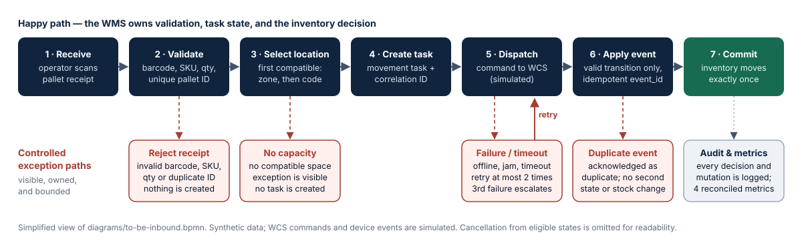
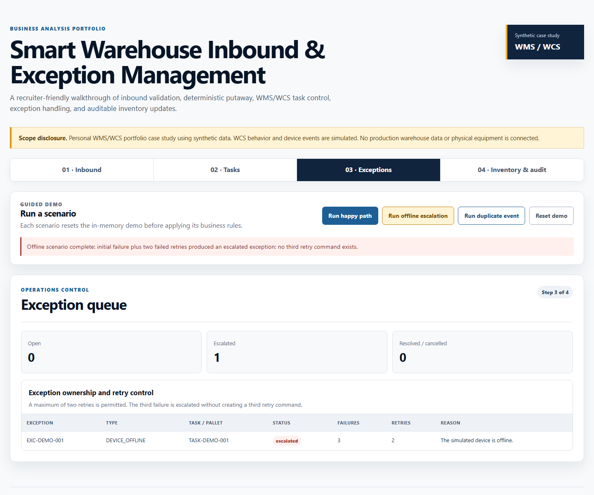
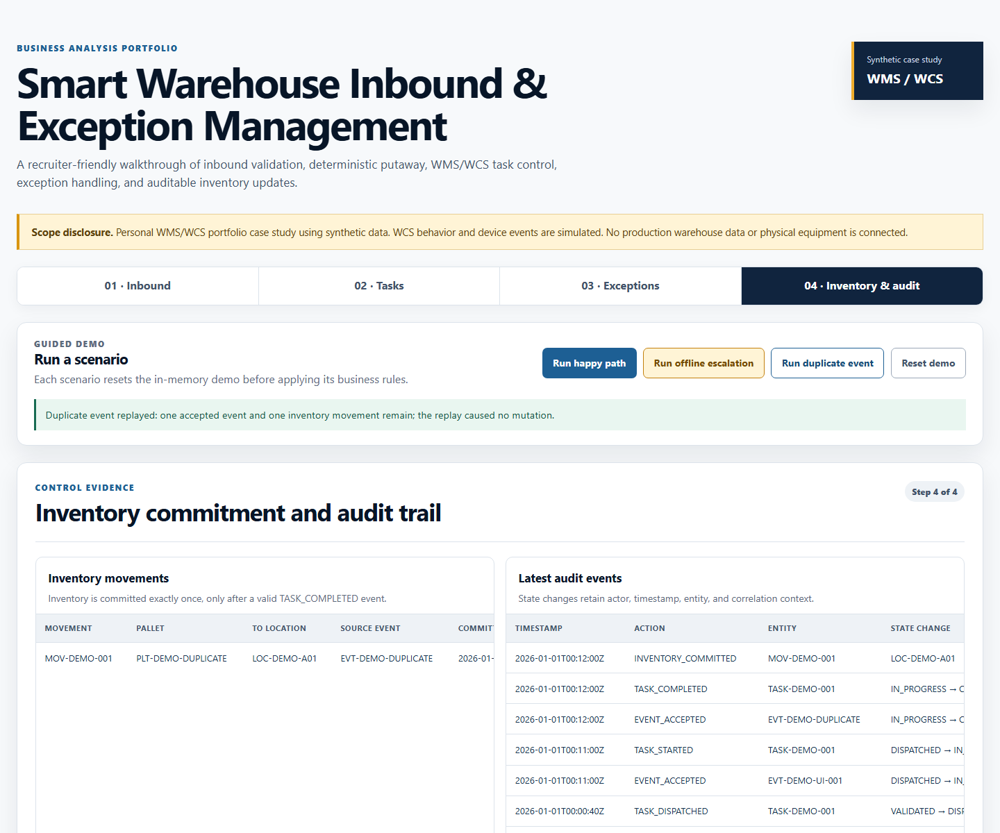

# Smart Warehouse Inbound and Exception Management

> Personal WMS/WCS portfolio case study using synthetic data. WCS behavior and device events are simulated.

**Business Analysis case study · WMS/WCS inbound putaway** — a self-directed project covering problem framing, stakeholder analysis, BPMN process models, an SRS with user stories and acceptance criteria, data and API contracts, a traceability matrix, and 14 executed UAT cases.

**[Live demo](https://qahuy.github.io/smart-warehouse-inbound-exceptions/demo/)** · **[Case study (web)](https://qahuy.github.io/smart-warehouse-inbound-exceptions/)** · **[Case study (PDF)](deliverables/Smart-Warehouse-BA-Case-Study.pdf)** · **[Case study (Word)](deliverables/Smart-Warehouse-BA-Case-Study.docx)** · **[One-page summary (PDF)](deliverables/Smart-Warehouse-BA-One-Pager.pdf)**



## 30-second summary

| | |
|---|---|
| **Problem** | Inbound checks are fragmented and exception visibility is poor, so nobody can say whether a pallet is safe to put away, who owns a failed movement, or whether inventory was updated too early. |
| **Goal** | Traceable pallet receipt and putaway with safe recovery: invalid pallets stopped early, every movement traceable, exceptions bounded, and inventory changed **exactly once** after verified completion. |
| **My role** | Sole business analyst on a self-directed case study, from discovery planning to UAT. |
| **Evidence** | 4 business needs · 10 functional requirements · 10 business rules · 5 NFRs · 12 user stories with 26 acceptance criteria · **14 / 14 UAT cases passed** · **0 orphaned requirements**. |
| **Not claimed** | No interview, site observation, measured benefit, or real device integration. The first step in a real engagement would be discovery with warehouse users. |

## What I did as the business analyst

| BA activity | Output | Where to look |
|---|---|---|
| Problem framing and scope | 4 business needs, in/out of scope, stable ID contract | [Case study brief](docs/01-case-study-brief.md) |
| Stakeholder analysis | 5 personas, influence/impact view, proposed RACI, 45-minute interview guide | [Stakeholders and interview guide](docs/02-stakeholders-and-interview-guide.md) |
| Assumptions and decisions | 3 assumptions and 4 decisions, each with rationale and a revisit trigger | [Assumptions and decisions](docs/03-assumptions-and-decisions.md) |
| Process analysis | As-Is and To-Be BPMN 2.0, gap analysis, system context, sequence, and state diagrams | [As-Is image](assets/diagrams/as-is-inbound.svg), [To-Be image](assets/diagrams/to-be-inbound.svg), [diagram sources](diagrams/) |
| Requirements | SRS/FSD-lite with functional requirements, business rules, NFRs, and a 13-code error catalogue | [SRS and FSD lite](docs/04-srs-fsd-lite.md) |
| Backlog and stories | Ordered backlog of 12 stories; INVEST check; positive and negative Given/When/Then criteria | [Backlog](docs/05-product-goal-and-backlog.md), [Stories](docs/06-user-stories-and-acceptance-criteria.md) |
| Data and interface contracts | 9-table schema, data dictionary, SQL controls, OpenAPI 3.1 with 8 operations | [Data dictionary](data/data-dictionary.md), [OpenAPI](api/openapi.yaml) |
| Validation | Clickable prototype, 14 automated UAT cases, traceability matrix, defect and change log | [UAT pack](docs/08-uat-pack-and-results.md), [RTM](docs/07-requirements-traceability-matrix.md) |

## Screenshots

| Offline device: two failed retries, then escalation | Duplicate event: still one inventory movement |
|---|---|
|  |  |

## Recruiter summary

- **Users:** inbound operator, warehouse supervisor, warehouse manager, integration engineer, and maintenance technician.
- **In scope:** barcode/SKU/quantity/duplicate validation, deterministic location selection, movement tracking, simulated device events, exception recovery, inventory audit, and synthetic metrics.
- **Out of scope:** outbound, cycle count, multi-warehouse, advanced FEFO, production optimization, enterprise authentication, and real ERP/PLC/robot/device integration.
- **Implemented evidence:** executable domain rules, static recruiter demo, data and API contracts, RTM, 14 / 14 passing UAT cases, and four screenshots.
- **Limitation:** this is a designed and simulated operating model, not evidence from a warehouse engagement, physical equipment test, or production system.

## Architecture direction

The browser demo sends synthetic pallet data to an in-memory WMS domain model. The WMS validates receipt, chooses a compatible location by an explicit rule, creates a movement task, and dispatches to a WCS simulator. Simulated device events drive task status. Only a valid completion event may commit inventory. The exception queue and audit trail expose failures, retries, escalation, cancellation, and duplicate events.

The artefact also includes BPMN/flow/sequence/state/data diagrams, a SQLite-compatible data contract, OpenAPI specification, and a dependency-free JavaScript simulator. No physical device or production environment is connected.

## Run the demo locally

From `prototype/` run `python -m http.server 8765 --bind 127.0.0.1`, then open the local address `127.0.0.1:8765` in a browser.

The guided buttons reset the in-memory state and run three recruiter-ready stories:

- **Happy path:** valid inbound, deterministic location assignment, task completion, and exactly-one inventory movement.
- **Offline escalation:** initial device failure plus two failed retries; the third failure escalates with no third retry command.
- **Duplicate event:** the same completion event is replayed with no second state or inventory mutation.

## Run the tests

```bash
node --test tests/domain.test.mjs tests/uat.test.mjs
```

```bash
python -m pip install -r requirements.txt
```

```bash
python -m pytest tests
```

## Delivery legend

| Label | Meaning in this portfolio |
|---|---|
| **Implemented** | Present and locally verifiable through source, executable tests, or retained visual evidence. |
| **Simulated** | Synthetic WCS/device behavior or demo data; never real equipment evidence. |
| **Designed only** | Proposed real-world extensions such as production persistence, authentication, observability, and physical device integration. |

## Delivery phases

The documents cite the delivery task that produced each artefact.

| Phase | Output |
|---|---|
| Task 1 | Foundation: case study brief, stakeholders, assumptions and decisions |
| Task 2 | Requirements: SRS/FSD-lite, Product Goal and backlog, user stories |
| Task 3 | Process and behaviour models: BPMN, context, sequence, and state diagrams |
| Task 4 | Data and interface contracts: schema, data dictionary, seed, SQL controls, OpenAPI |
| Task 6 | Accessible browser prototype |
| Task 7 | UAT execution, traceability matrix, defect and change log, user guide |

## Current artifact map

| Artifact | Purpose | Current status |
|---|---|---|
| [Case study brief](docs/01-case-study-brief.md) | Problem, goal, scope, business needs, and stable ID contract | Implemented |
| [Stakeholders and interview guide](docs/02-stakeholders-and-interview-guide.md) | Proposed stakeholder model and unexecuted interview plan | Implemented; engagement is Designed only |
| [Assumptions and decisions](docs/03-assumptions-and-decisions.md) | Assumption, decision, proposal, and revisit controls | Implemented |
| [SRS and FSD lite](docs/04-srs-fsd-lite.md) | 4 needs, 10 functional requirements, 10 business rules, 5 NFRs, errors, and interfaces | Implemented; draft until reviewed by real stakeholders |
| [Product goal and backlog](docs/05-product-goal-and-backlog.md) | Product goal and dependency-aware ordering for 12 stories | Implemented; draft until reviewed by real stakeholders |
| [Stories and acceptance criteria](docs/06-user-stories-and-acceptance-criteria.md) | Testable positive and negative behavior | Implemented; draft until reviewed by real stakeholders |
| [Traceability matrix](docs/07-requirements-traceability-matrix.md) | BN-to-UAT coverage with retained evidence | Implemented; 0 orphaned requirements |
| [UAT pack](docs/08-uat-pack-and-results.md) | 14 executed acceptance cases and residual limitations | Implemented; 14 / 14 PASS |
| [Defect and change log](docs/09-defect-and-change-log.md) | Defect, change, and assumption-gap classification | Implemented; 0 open functional defects |
| [User guide and demo script](docs/10-user-guide-and-demo-script.md) | Local setup and five-minute recruiter walkthrough | Implemented |
| [OpenAPI contract](api/openapi.yaml) | Simulated receipt, task, event, retry, exception, inventory, audit, and metric interfaces | Implemented and schema-tested |
| [Data contract](data/schema.sql) | SQLite-compatible relational model, seed data, metrics, and lineage | Implemented and query-tested |
| [Local prototype](prototype/index.html) | Accessible responsive UI backed by the deterministic simulator | Implemented and visually checked |
| [UAT automation](tests/uat.test.mjs) | Executable evidence for UAT-01 through UAT-14 | Implemented; 14 / 14 PASS |
| [Structure tests](tests/test_structure.py) | Foundation, disclosure, ID, link, neutral-question, and privacy checks | Implemented |
| [Recruiter pack](deliverables/) | PDF and Word case study and a one-page summary, generated from one source | Implemented |
| [Rendered diagrams](assets/diagrams/) | SVG/PNG images of the BPMN models and a simplified To-Be overview | Implemented |

## Rebuild the recruiter pack

The PDF, Word, and web versions are generated from [tools/portfolio/content.mjs](tools/portfolio/content.mjs), so they always say the same thing. Rebuilding needs Node 20+ and a local Chrome or Edge.

```bash
npm install
```

```bash
npm run build:docs
```

`npm run render:bpmn` re-renders the BPMN images, and `npm run build:site` assembles the GitHub Pages site into `_site/`.

## Evidence and privacy boundary

All examples are synthetic. The project contains no client names, private links, real identifiers, credentials, production screenshots, or copied internal rules. Stakeholder authority is proposed for the simulation. No interview, site observation, warehouse baseline, measured benefit, hardware test, customer sign-off, or production validation is claimed.

Public URL: https://github.com/QaHuy/smart-warehouse-inbound-exceptions
