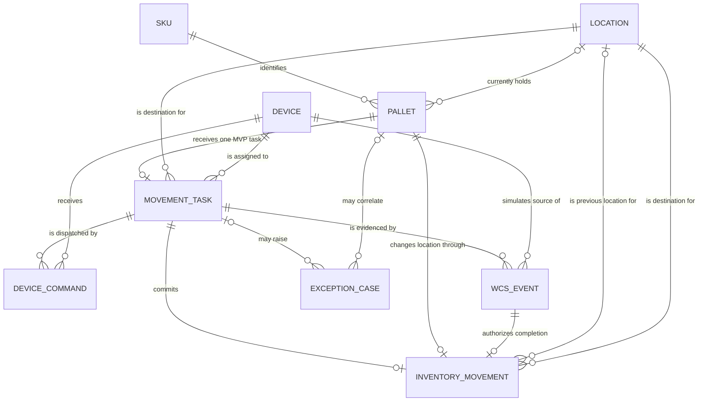

# Smart Warehouse Data Dictionary and Logical ERD — Draft portfolio contract

## Status, disclosure, and evidence boundary

> Personal WMS/WCS portfolio case study using synthetic data. WCS behavior and device events are simulated.

Status: proposed local simulator contract. This document describes the actual columns in `data/schema.sql`; it is not a production schema, connected integration, observed warehouse model, or authorization for operational reuse. Physical names, SQLite types, keys, and checks are portfolio decisions. A business data owner must confirm semantics, while an architect and DBA must confirm physical design before external reuse.

Evidence is limited to the approved portfolio spec/plan, Task 1–3 artifacts, the SQLite schema, synthetic seed, OpenAPI contract, and local tests. All examples are generalized synthetic values. Sensitivity classifications are proposals and every listed field is `No PII` in this dataset.

### Source index

- Physical tables and columns: `data/schema.sql:5`, `:14`, `:28`, `:35`, `:45`, `:63`, `:74`, `:85`, and `:95`; exactly-once triggers start at `:114` and `:129`.
- Functional requirements and business rules: `docs/04-srs-fsd-lite.md:91-231`; the error catalogue starts at `docs/04-srs-fsd-lite.md:329`.
- Event/state behavior: `diagrams/task-state.md:44` (State × Event matrix) and `diagrams/task-state.md:61` (transition table).
- API transport/read-model proposal: `api/openapi.yaml`; SQL reconciliation definitions: `data/validation-queries.sql`.

## Logical ERD

Relationship labels are business verbs. Cardinalities reflect this MVP contract, not a generalized warehouse model.

The optional task/pallet links on `exception_case` allow errors before task creation. `movement_task.pallet_id` is unique in this MVP, and both `inventory_movement.task_id` and `source_event_id` are unique. The latter relationships implement exactly-once inventory evidence at the database seam (`BR-06`, `BR-07`).

## Business glossary

| Term | Meaning and grain | Source |
|---|---|---|
| SKU | Synthetic stock-keeping master record used to validate a receipt and choose compatible storage. | `FR-02`, `BR-02` |
| Pallet | One synthetic inbound handling unit containing one SKU and one lot. | `AS-01`, `FR-01` |
| Location | One storage position with an integer pallet capacity and compatibility key. | `AS-03`, `FR-04`, `BR-04` |
| Movement task | One planned movement for one pallet to one destination in this MVP. | `FR-05`, `BR-05` |
| Device command | One initial dispatch or bounded retry attempt sent to a simulated device. | `FR-06`, `BR-08` |
| WCS event | One uniquely identified simulated event offered as task-state evidence. | `FR-07`, `BR-07` |
| Inventory movement | The single committed location change for a completed task, tied to its completion event. | `FR-10`, `BR-06` |
| Exception case | A traceable validation, capacity, device, state, retry, or cancellation problem. | `FR-08`, `FR-09` |
| Dispatched cohort | Tasks whose `dispatched_at` is non-NULL, meaning they reached `DISPATCHED` at least once. | `BR-10` |
| Failure evidence | `failure_count > 0`, representing that a dispatched cohort task ever failed or timed out. | `BR-08`, `BR-09`, `BR-10` |

## Entity dictionary

Owners below are proposed role owners for the simulation; they do not assign authority in a real organization.

| Entity | Business meaning | Identifier | Proposed lifecycle/data owner | Source/evidence | Sensitivity / PII |
|---|---|---|---|---|---|
| `sku` | Receipt-validation and compatibility master | `sku_id` | Warehouse master-data role | `FR-02`, `BR-02`; synthetic seed | Synthetic reference data; No PII |
| `location` | Capacity and compatibility master for deterministic putaway | `location_id` | Warehouse policy role | `FR-04`, `BR-04`; synthetic seed | Synthetic reference data; No PII |
| `device` | Simulated conveyor, lift, or robot endpoint | `device_id` | Integration/maintenance role | `FR-06`; synthetic seed | Synthetic technical data; No PII |
| `pallet` | Accepted inbound handling unit and committed current position | `pallet_id` | Inbound/inventory role | `FR-01..FR-03`, `AS-01` | Synthetic operational data; No PII |
| `movement_task` | Planned and stateful pallet movement | `task_id` | WMS process role | `FR-05`, `BR-05` | Synthetic operational data; No PII |
| `device_command` | Initial or retry dispatch evidence | `command_id` | Integration role | `FR-06`, `BR-08` | Simulated technical data; No PII |
| `wcs_event` | Idempotent simulated event evidence | `event_id` | Integration role | `FR-07`, `BR-07` | Simulated technical data; No PII |
| `inventory_movement` | Exactly-once committed position change | `movement_id` | Inventory-control role | `FR-10`, `BR-06` | Synthetic operational data; No PII |
| `exception_case` | Visible problem and recovery/escalation evidence | `exception_id` | Warehouse-supervision role | `FR-08`, `FR-09` | Synthetic operational data; No PII |

## Physical column dictionary

Every physical column from `data/schema.sql` appears exactly once below. UTC timestamps use exact whole-second UTC text in `YYYY-MM-DDTHH:MM:SSZ` form; fractional seconds and numeric offsets are rejected rather than passed through. `Nullable: yes` always states what NULL means; no NULL is silently converted to zero or an empty string.

| Data element | Business meaning | SQLite type / format | Nullable rule / NULL meaning | Valid values / constraint | Synthetic example | Source | Linked FR/BR/NFR | Sensitivity / PII |
|---|---|---|---|---|---|---|---|---|
| `sku.sku_id` | Stable simulator SKU identifier | TEXT | No | Primary key; explicit NOT NULL | `SKU-DEMO-A` | SQL portfolio decision; synthetic seed | `FR-02`, `BR-02` | Synthetic reference; No PII |
| `sku.barcode` | Simulator barcode mapped to one SKU | TEXT | No | Unique and non-empty | `SIMSKU0001` | SQL portfolio decision; synthetic seed | `FR-02`, `BR-02` | Synthetic reference; No PII |
| `sku.name` | Recruiter-readable synthetic item name | TEXT | No | Non-empty | `Demo ambient item A` | SQL portfolio decision; synthetic seed | `FR-02`, `NFR-05` | Synthetic reference; No PII |
| `sku.description` | Optional explanation of the synthetic SKU | TEXT | Yes; NULL means no extra description | Free synthetic text | `Synthetic active SKU for ambient storage.` | SQL portfolio decision; synthetic seed | `FR-02`, `NFR-05` | Synthetic reference; No PII |
| `sku.is_active` | Whether receipt validation may use the SKU | INTEGER boolean | No | Integer 0 or 1 | `1` | `BR-02`; synthetic seed | `FR-02`, `BR-02` | Synthetic reference; No PII |
| `sku.compatibility_key` | Storage compatibility category | TEXT | No | Must match eligible location key | `AMBIENT` | `BR-04`; portfolio simplification | `FR-04`, `BR-04` | Synthetic reference; No PII |
| `location.location_id` | Stable location identifier | TEXT | No | Primary key; explicit NOT NULL | `LOC-DEMO-A01` | SQL portfolio decision; synthetic seed | `FR-04`, `BR-04` | Synthetic reference; No PII |
| `location.location_code` | Human-readable selector and tie-break code | TEXT | No | Unique | `A-01` | `DEC-01`; synthetic seed | `FR-04`, `BR-04` | Synthetic reference; No PII |
| `location.zone_code` | Groups locations into a synthetic zone | TEXT | No | Non-empty | `ZONE-A` | SQL portfolio decision; synthetic seed | `FR-04`, `BR-04` | Synthetic reference; No PII |
| `location.zone_priority` | First deterministic location ordering key | INTEGER | No | Integer at least 0 | `1` | `DEC-01`; synthetic seed | `FR-04`, `BR-04` | Synthetic reference; No PII |
| `location.compatibility_key` | Storage compatibility accepted by the location | TEXT | No | Compared exactly with SKU key | `AMBIENT` | `BR-04`; synthetic seed | `FR-04`, `BR-04` | Synthetic reference; No PII |
| `location.pallet_capacity` | Maximum integer pallet count | INTEGER | No | Positive integer | `2` | `AS-03`; synthetic seed | `FR-04`, `BR-04` | Synthetic reference; No PII |
| `location.used_pallet_count` | Currently committed pallet count | INTEGER | No | Integer from 0 through capacity; default 0 | `0` | `AS-03`; SQL portfolio decision | `FR-04`, `BR-04` | Synthetic operational; No PII |
| `device.device_id` | Stable simulated device identifier | TEXT | No | Primary key; explicit NOT NULL | `DEV-DEMO-CONV` | SQL portfolio decision; synthetic seed | `FR-06`, `NFR-05` | Simulated technical; No PII |
| `device.device_name` | Readable simulated device label | TEXT | No | Non-empty | `Simulated inbound conveyor` | Synthetic seed | `FR-06`, `NFR-05` | Simulated technical; No PII |
| `device.device_type` | Simulator equipment category | TEXT enum | No | `conveyor`, `lift`, `robot` | `conveyor` | Task 4 brief; synthetic seed | `FR-06`, `NFR-05` | Simulated technical; No PII |
| `device.status` | Current simulated availability | TEXT enum | No | `online`, `offline` | `online` | Task 4 brief; synthetic seed | `FR-06`, `BR-05` | Simulated technical; No PII |
| `pallet.pallet_id` | Unique inbound handling-unit identity | TEXT | No | Primary key; explicit NOT NULL | `PLT-SYN-001` | `FR-01`, `BR-03` | `FR-01`, `BR-03` | Synthetic operational; No PII |
| `pallet.receipt_barcode` | Barcode captured for this receipt | TEXT | No | Non-empty simulator input | `RCPT000001` | `FR-01`, `FR-02` | `FR-01`, `FR-02` | Synthetic operational; No PII |
| `pallet.sku_id` | Known SKU contained by the pallet | TEXT | No | Foreign key to `sku.sku_id` | `SKU-DEMO-A` | `AS-01`, `BR-02` | `FR-02`, `BR-02` | Synthetic operational; No PII |
| `pallet.lot_code` | One lot carried by this MVP pallet | TEXT | No | Non-empty | `LOT-001` | `AS-01`; SQL portfolio decision | `FR-01`, `NFR-05` | Synthetic operational; No PII |
| `pallet.quantity` | Count of units received | INTEGER | No | Positive integer | `10` | `AS-02`, `BR-01` | `FR-02`, `BR-01` | Synthetic operational; No PII |
| `pallet.received_at` | UTC receipt timestamp | TEXT UTC ISO 8601 | No | `YYYY-MM-DDTHH:MM:SSZ` check | `2026-01-01T00:00:00Z` | `DEC-04`; SQL portfolio decision | `FR-01`, `NFR-02` | Synthetic operational; No PII |
| `pallet.current_location_id` | Last committed pallet position | TEXT | Yes; NULL means receipt exists but no inventory commit yet | Foreign key to `location.location_id` | `LOC-DEMO-A01` | `DEC-02`, `BR-06` | `FR-10`, `BR-06` | Synthetic operational; No PII |
| `movement_task.task_id` | Stable movement-task identifier | TEXT | No | Primary key; explicit NOT NULL | `TASK-SYN-001` | `FR-05`; SQL portfolio decision | `FR-05`, `NFR-02` | Synthetic operational; No PII |
| `movement_task.pallet_id` | Pallet moved by this task | TEXT | No | Unique foreign key to `pallet.pallet_id` for MVP | `PLT-SYN-001` | Task 4 brief | `FR-05`, `BR-03` | Synthetic operational; No PII |
| `movement_task.destination_location_id` | Planned and eventual committed destination | TEXT | No | Foreign key to `location.location_id` | `LOC-DEMO-A01` | `FR-04`, `FR-05` | `FR-04`, `BR-04` | Synthetic operational; No PII |
| `movement_task.device_id` | Simulated device assigned to execute | TEXT | No | Foreign key to `device.device_id` | `DEV-DEMO-CONV` | `FR-06`; SQL portfolio decision | `FR-06`, `NFR-02` | Simulated technical; No PII |
| `movement_task.state` | Current task lifecycle state | TEXT enum | No | `CREATED`, `VALIDATED`, `DISPATCHED`, `IN_PROGRESS`, `COMPLETED`, `FAILED`, `TIMED_OUT`, `CANCELLED` | `VALIDATED` | Task 2 BR-05 and Task 3 state model | `FR-05`, `BR-05` | Synthetic operational; No PII |
| `movement_task.retry_count` | Redispatch count excluding initial attempt | INTEGER | No | Integer 0 through 2; default 0 | `1` | `BR-08` | `FR-09`, `BR-08` | Synthetic operational; No PII |
| `movement_task.failure_count` | Failure evidence across initial and retry attempts | INTEGER | No | Integer 0 through 3; default 0 | `2` | `BR-08`, `BR-09` | `FR-09`, `BR-09` | Synthetic operational; No PII |
| `movement_task.correlation_id` | Identity used across task, command, and event | TEXT | No | Non-empty | `CORR-SYN-001` | Task 2 interface overview | `FR-05`, `NFR-02` | Synthetic technical; No PII |
| `movement_task.created_at` | UTC task creation timestamp | TEXT UTC ISO 8601 | No | `YYYY-MM-DDTHH:MM:SSZ` check | `2026-01-01T00:00:10Z` | `DEC-04` | `FR-05`, `NFR-02` | Synthetic operational; No PII |
| `movement_task.validated_at` | UTC time task links became valid | TEXT UTC ISO 8601 | Yes; NULL means not validated | UTC format when present | `2026-01-01T00:00:20Z` | `DEC-04`; SQL portfolio decision | `FR-05`, `NFR-02` | Synthetic operational; No PII |
| `movement_task.dispatched_at` | First UTC time task reached DISPATCHED | TEXT UTC ISO 8601 | Yes; NULL means task never entered dispatched cohort | UTC format when present | `2026-01-01T00:00:30Z` | `BR-10`; SQL portfolio decision | `FR-10`, `BR-10` | Synthetic operational; No PII |
| `movement_task.completed_at` | UTC verified completion time | TEXT UTC ISO 8601 | Yes; NULL means task has no valid completion | UTC format when present | `2026-01-01T00:02:30Z` | `DEC-02`, `DEC-04` | `FR-10`, `BR-06` | Synthetic operational; No PII |
| `device_command.command_id` | Stable command identifier | TEXT | No | Primary key; explicit NOT NULL | `CMD-SYN-001` | Task 2 interface overview | `FR-06`, `NFR-02` | Simulated technical; No PII |
| `device_command.task_id` | Originating task | TEXT | No | Foreign key to `movement_task.task_id` | `TASK-SYN-001` | `FR-06` | `FR-06`, `NFR-02` | Simulated technical; No PII |
| `device_command.device_id` | Simulated command recipient | TEXT | No | Foreign key to `device.device_id` | `DEV-DEMO-CONV` | `FR-06` | `FR-06`, `NFR-02` | Simulated technical; No PII |
| `device_command.attempt_number` | Initial or retry attempt index | INTEGER | No | 0 initial, 1 retry one, 2 retry two; unique per task | `0` | `BR-08` | `FR-09`, `BR-08` | Simulated technical; No PII |
| `device_command.command_status` | Persisted simulated command outcome | TEXT enum | No | `CREATED`, `SENT`, `ACCEPTED`, `FAILED`, `TIMED_OUT`, `CANCELLED` | `SENT` | SQL portfolio decision; Task 3 command flow | `FR-06`, `BR-05` | Simulated technical; No PII |
| `device_command.correlation_id` | Cross-contract trace identity | TEXT | No | Non-empty | `CORR-SYN-001` | Task 2 interface overview | `FR-06`, `NFR-02` | Synthetic technical; No PII |
| `device_command.sent_at` | UTC command timestamp | TEXT UTC ISO 8601 | No | `YYYY-MM-DDTHH:MM:SSZ` check | `2026-01-01T00:00:30Z` | `DEC-04` | `FR-06`, `NFR-02` | Simulated technical; No PII |
| `wcs_event.event_id` | Global idempotency key for the local store | TEXT | No | Primary key, unique, and explicit NOT NULL | `EVT-SYN-001` | `BR-07` | `FR-07`, `BR-07` | Simulated technical; No PII |
| `wcs_event.task_id` | Task to which event evidence is correlated | TEXT | No | Foreign key to `movement_task.task_id` | `TASK-SYN-001` | `FR-07` | `FR-07`, `NFR-02` | Simulated technical; No PII |
| `wcs_event.device_id` | Simulated event source | TEXT | No | Foreign key to `device.device_id` | `DEV-DEMO-CONV` | `FR-07` | `FR-07`, `NFR-05` | Simulated technical; No PII |
| `wcs_event.event_type` | Documented task event | TEXT enum | No | `TASK_STARTED`, `TASK_COMPLETED`, `TASK_FAILED`, `TASK_TIMEOUT` | `TASK_COMPLETED` | Task 3 state/sequence contract | `FR-07`, `BR-05` | Simulated technical; No PII |
| `wcs_event.correlation_id` | Event-to-task correlation identity | TEXT | No | Non-empty | `CORR-SYN-001` | Task 2 interface overview | `FR-07`, `NFR-02` | Synthetic technical; No PII |
| `wcs_event.event_at` | UTC event occurrence timestamp | TEXT UTC ISO 8601 | No | `YYYY-MM-DDTHH:MM:SSZ` check | `2026-01-01T00:02:30Z` | `DEC-04` | `FR-07`, `NFR-02` | Simulated technical; No PII |
| `wcs_event.simulated` | Explicit marker that event is not physical evidence | INTEGER boolean | No | Must equal 1 | `1` | Portfolio disclosure boundary | `FR-07`, `NFR-05` | Simulated technical; No PII |
| `wcs_event.payload_json` | Optional diagnostic payload retained as text | TEXT JSON text | Yes; NULL means no optional diagnostic detail | Must remain synthetic when present | `{"sensor":"clear"}` | SQL portfolio decision | `FR-07`, `NFR-05` | Simulated technical; No PII |
| `inventory_movement.movement_id` | Stable committed-movement identifier | TEXT | No | Primary key; explicit NOT NULL | `MOV-SYN-001` | `FR-10`; SQL portfolio decision | `FR-10`, `NFR-02` | Synthetic operational; No PII |
| `inventory_movement.task_id` | Completed task committed once | TEXT | No | Unique foreign key to `movement_task.task_id` | `TASK-SYN-001` | `BR-06` | `FR-10`, `BR-06` | Synthetic operational; No PII |
| `inventory_movement.pallet_id` | Pallet whose position changed | TEXT | No | Foreign key to `pallet.pallet_id`; trigger must match task | `PLT-SYN-001` | `BR-06`; SQL trigger | `FR-10`, `BR-06` | Synthetic operational; No PII |
| `inventory_movement.from_location_id` | Previously committed location | TEXT | Yes; NULL means inbound pallet had no prior committed location | Foreign key to `location.location_id` | `LOC-DEMO-B01` | SQL portfolio decision | `FR-10`, `BR-06` | Synthetic operational; No PII |
| `inventory_movement.to_location_id` | Completed destination location | TEXT | No | Foreign key to location; trigger must match task destination | `LOC-DEMO-A01` | `BR-06`; SQL trigger | `FR-10`, `BR-06` | Synthetic operational; No PII |
| `inventory_movement.source_event_id` | Completion event authorizing the movement | TEXT | No | Unique foreign key to `wcs_event.event_id`; must be matching `TASK_COMPLETED` | `EVT-SYN-001` | `BR-06`, `BR-07`; SQL trigger | `FR-10`, `BR-07` | Simulated technical; No PII |
| `inventory_movement.committed_at` | UTC inventory commitment time | TEXT UTC ISO 8601 | No | `YYYY-MM-DDTHH:MM:SSZ` check | `2026-01-01T00:02:30Z` | `DEC-04`; SQL portfolio decision | `FR-10`, `NFR-02` | Synthetic operational; No PII |
| `exception_case.exception_id` | Stable exception identifier | TEXT | No | Primary key; explicit NOT NULL | `EXC-SYN-001` | `FR-08`; SQL portfolio decision | `FR-08`, `NFR-02` | Synthetic operational; No PII |
| `exception_case.task_id` | Related movement task when one exists | TEXT | Yes; NULL means error occurred before task creation | Foreign key to `movement_task.task_id` | `TASK-SYN-001` | `FR-08` pre-task boundary | `FR-08`, `BR-05` | Synthetic operational; No PII |
| `exception_case.pallet_id` | Related pallet when one exists | TEXT | Yes; NULL means receipt identity was not persisted | Foreign key to `pallet.pallet_id` | `PLT-SYN-001` | `FR-08` pre-task boundary | `FR-08`, `BR-03` | Synthetic operational; No PII |
| `exception_case.exception_type` | Task 2 error/exception vocabulary | TEXT enum | No | `INVALID_BARCODE`, `UNKNOWN_OR_INACTIVE_SKU`, `INVALID_QUANTITY`, `DUPLICATE_PALLET`, `NO_AVAILABLE_LOCATION`, `DEVICE_OFFLINE`, `PALLET_JAM`, `TASK_TIMEOUT`, `INVALID_TRANSITION`, `UNKNOWN_TASK`, `DUPLICATE_EVENT`, `RETRY_LIMIT_REACHED`, `CANCELLATION_NOT_ALLOWED` | `DEVICE_OFFLINE` | Task 2 error catalogue | `FR-08`, `FR-09` | Synthetic operational; No PII |
| `exception_case.status` | Exception lifecycle status | TEXT enum | No | `open`, `resolved`, `escalated`, `cancelled` | `open` | Task 4 brief; portfolio decision | `FR-08`, `BR-09` | Synthetic operational; No PII |
| `exception_case.failure_count` | Failure evidence captured with exception | INTEGER | No | Integer 0 through 3; default 0 | `2` | `BR-08`, `BR-09` | `FR-09`, `BR-09` | Synthetic operational; No PII |
| `exception_case.retry_count` | Retry evidence captured with exception | INTEGER | No | Integer 0 through 2; default 0 | `1` | `BR-08` | `FR-09`, `BR-08` | Synthetic operational; No PII |
| `exception_case.reason` | Human-readable synthetic diagnostic reason | TEXT | No | Non-empty synthetic text | `Synthetic device unavailable.` | `FR-08`; SQL portfolio decision | `FR-08`, `NFR-05` | Synthetic operational; No PII |
| `exception_case.opened_at` | UTC exception creation time | TEXT UTC ISO 8601 | No | `YYYY-MM-DDTHH:MM:SSZ` check | `2026-01-01T00:00:40Z` | `DEC-04` | `FR-08`, `NFR-02` | Synthetic operational; No PII |
| `exception_case.updated_at` | UTC last exception evidence change | TEXT UTC ISO 8601 | No | `YYYY-MM-DDTHH:MM:SSZ` check | `2026-01-01T00:01:40Z` | `DEC-04` | `FR-09`, `NFR-02` | Synthetic operational; No PII |
| `exception_case.resolved_at` | UTC resolution time | TEXT UTC ISO 8601 | Yes; NULL means not resolved; escalated/cancelled remain separately classified | UTC format when present | `2026-01-01T00:02:40Z` | SQL portfolio decision | `FR-08`, `NFR-02` | Synthetic operational; No PII |

## API to schema to read-model and metric lineage

| API operation | Schema writes/reads | Read model or metric | Transformation and null behavior | Links |
|---|---|---|---|---|
| `POST /pallets` | Validates `sku`; API/domain orchestration writes `pallet` and creates `movement_task` after selecting a compatible `location`; may write pre-task `exception_case` | Receipt plus validated task response | Quantity remains integer; successful acceptance creates the `FR-05` task and returns the validated task; unknown/inactive SKU, duplicate identity, or no destination fails closed | `FR-01..FR-05`, `BR-01..BR-04` |
| `POST /tasks/{taskId}/dispatch` | Reads `movement_task`, `device`; writes `device_command`; updates task or writes exception evidence | Task result | Attempt 0 is initial dispatch; offline produces failure evidence and no false execution | `FR-06`, `BR-05`, `BR-08` |
| `POST /wcs/events` | De-duplicates then writes `wcs_event`; may update task and write `inventory_movement`/`exception_case` | Event result with `duplicate` | Duplicate returns success without another state/inventory mutation; only matching completion can commit | `FR-07`, `BR-06`, `BR-07` |
| `POST /tasks/{taskId}/retry` | Reads failure/exception evidence; writes attempt 1 or 2 command and updates task | Task result | Initial failure is not a retry; failure 3 escalates and prevents attempt 3 | `FR-09`, `BR-08`, `BR-09` |
| `POST /tasks/{taskId}/cancel` | Reads current task; updates eligible task and exception | Task result | Terminal/undocumented origins fail without mutation | `FR-09`, `BR-05` |
| `GET /tasks` | Reads `movement_task` with pallet/device/destination identifiers | Task list | Missing timestamps remain JSON null; no synthetic default timestamp is invented | `FR-10`, `NFR-02` |
| `GET /inventory` | Reads `pallet` and `inventory_movement` | Inventory/audit list | Planned destination is not shown as committed before valid completion | `FR-10`, `BR-06` |
| `GET /metrics` | Reads `movement_task` only | Four metric values plus dispatched count | Cohort is `dispatched_at IS NOT NULL`; SQL NULL is presented as proposed `N/A` | `FR-10`, `BR-10` |

Task creation after a valid pallet receipt is performed by API/domain orchestration; it is not an automatic SQL trigger side effect.

Integration direction is browser → WMS for requests, WMS → simulated WCS for commands, and simulated WCS → WMS event intake for events. Types are preserved; no rounding or currency conversion applies. The API/domain layer must normalize timestamps to whole-second UTC with a terminal `Z` before persistence; SQLite and OpenAPI then preserve that exact value. Fractional seconds, numeric offsets, and malformed timestamps are rejected rather than silently converted. Duplicate, late, unknown, malformed, and out-of-sequence policies beyond the locked state/idempotency rules remain human review items.

## Metric contract

| Metric | Grain | Cohort/filter | Final formula | Timestamp logic | Currency | NULL/empty behavior |
|---|---|---|---|---|---|---|
| Completion Rate | One movement task | `dispatched_at IS NOT NULL` | completed cohort tasks / dispatched cohort tasks | State `COMPLETED`; first dispatch timestamp defines cohort | N/A | SQL NULL when denominator is 0; proposed display `N/A` |
| Exception Rate | One movement task | `dispatched_at IS NOT NULL` | cohort tasks with `failure_count > 0` / dispatched cohort tasks | Failure evidence means ever failed or timed out; not only current state | N/A | SQL NULL when denominator is 0; proposed display `N/A` |
| First Pass Success Rate | One movement task | `dispatched_at IS NOT NULL` | completed cohort tasks with `retry_count = 0` / dispatched cohort tasks | Completion is valid `completed_at`; initial dispatch is attempt 0 | N/A | SQL NULL when denominator is 0; proposed display `N/A` |
| Average Simulated Cycle Time | One completed movement task, averaged over cohort | Dispatched tasks currently `COMPLETED` with non-NULL timestamps | average of `completed_at - dispatched_at` in seconds | UTC seconds; no business-hours adjustment | N/A | SQL NULL when completed cohort is empty; proposed display `N/A` |

Worked fixture used by tests: four dispatched tasks, two completed, three with failure evidence, and one completed without retry; completion rate `2/4 = 0.50`, exception rate `3/4 = 0.75`, first pass success `1/4 = 0.25`, and completed cycle times 60 and 180 seconds average to `120` seconds. One additional `VALIDATED` undispatched task affects none of the results.

## Conflict and gap log

| Topic | Current portfolio treatment | Gap/conflict | Human checkpoint |
|---|---|---|---|
| Event vocabulary | Exactly `TASK_STARTED`, `TASK_COMPLETED`, `TASK_FAILED`, `TASK_TIMEOUT` | Device acknowledgement meaning is unresolved; no extra task event is invented | Integration owner confirms acknowledgement and ordering semantics |
| Physical completion | Unique matching `TASK_COMPLETED` is the SQL inventory gate | No physical sensor or dual-confirmation evidence exists | Operations and integration owners confirm authority |
| Pallet composition | One SKU and one lot | Mixed SKU/lot handling is out of MVP | Inbound and inventory owners review `AS-01` |
| Capacity | Integer pallet slots and exact compatibility key | Weight, dimension, hazard, stacking, and shared-slot rules are absent | Warehouse policy owner reviews `AS-03` |
| Cancellation | API exposes state-gated request; schema stores state/result evidence | Safe-stop acknowledgement during motion is unresolved | Supervisor, maintenance, integration, and safety roles decide |
| Failure history | `failure_count > 0` is approved simulator evidence for Exception Rate | A normalized state-transition audit table is not part of Task 4 | Architect and metric owner decide whether future audit storage is required |
| JSON payload | Optional synthetic text payload | SQLite JSON validation and retention are not specified | Architect/security/data owner confirm if retained externally |
| Data ownership | Role owners are proposed | No real governance has been confirmed | Authorized sponsor assigns accountable owners |

## Human review boundary

This artifact is recruiter-readable design evidence, not a warehouse data standard. Before external reuse, business and data owners must confirm every definition, enum, null meaning, metric cohort, and relationship; architects/developers must confirm transport and correlation behavior; a DBA must review physical keys, checks, triggers, retention, concurrency, and migration design. Safety and operations owners retain decisions about physical completion, retry, cancellation, and recovery. Local tests prove only conformance to this synthetic portfolio contract.
