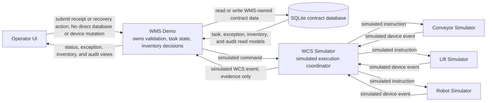

# System Context — Smart Warehouse Inbound and Exception Management

> Personal WMS/WCS portfolio case study using synthetic data. WCS behavior and device events are simulated.

## Scope and reading guide

This context view shows the seven core components and the direction of responsibility in the local portfolio design. Arrows mean a request, decision, persisted contract record, simulated command, or simulated event; they do not claim a physical integration. The Operator UI can submit or read through the WMS Demo only. It has no direct path that mutates the database or any device simulator.

## Business walkthrough

1. The Operator UI sends synthetic receipt or recovery intent to the WMS Demo and reads the resulting status.
2. The WMS Demo owns validation, deterministic location selection, task lifecycle, exception handling, idempotency, and the decision to commit inventory.
3. The SQLite contract database stores the WMS-owned data contract; it is not called directly by the browser or the device simulators.
4. The WMS Demo sends simulated movement commands to the WCS Simulator. Conveyor, lift, and robot behavior stays simulated behind that boundary.
5. Device evidence returns through the WCS Simulator. A device event cannot directly mutate inventory; only WMS processing of a unique valid `TASK_COMPLETED` can do that once.

## Linked requirements and rules

- Receipt and location boundary: `FR-01..FR-04`, `BR-01..BR-04`, `BN-01`.
- Task, command, and event responsibility: `FR-05..FR-07`, `BR-05`, `BN-02`.
- Exception and recovery visibility: `FR-08`, `FR-09`, `BR-08`, `BR-09`, `BN-03`.
- Inventory and duplicate protection: `FR-10`, `BR-06`, `BR-07`, `BN-04`.
- Local and synthetic boundary: `NFR-04`, `NFR-05`.

## Assumptions and gaps

- The SQLite component is a designed contract boundary for a later task; this diagram does not claim the schema or application is implemented yet.
- One synthetic compatibility key stands in for warehouse-specific location constraints.
- Command acknowledgement, device routing, clock ordering, and safe-stop behavior still require contract detail.
- All role ownership and device behavior are portfolio proposals or simulations, not observed operating practice.

## Human review boundary

An authorized process owner must confirm operational responsibility, and technical/safety owners must confirm device, acknowledgement, recovery, and inventory boundaries before any reuse outside this personal simulator. Diagram syntax and automated checks cannot provide that human confirmation.

