# Movement Task State Model — BR-05 Contract

> Personal WMS/WCS portfolio case study using synthetic data. WCS behavior and device events are simulated.

## Scope and reading guide

This document defines the complete movement-task state namespace for the synthetic simulator. The Mermaid diagram shows only allowed transitions. Labels follow `trigger [guard] / effect`. The matrix then distinguishes valid actions, forbidden transitions, and behavior whose event meaning is not defined. The detailed table makes actor, audit evidence, and linked rules explicit.

```mermaid
stateDiagram-v2
    [*] --> CREATED
    CREATED --> VALIDATED: validate [valid task links] / record validation
    CREATED --> CANCELLED: cancel [proposed eligible] / close task and audit
    VALIDATED --> DISPATCHED: dispatch [device available] / persist command first
    VALIDATED --> FAILED: dispatch [device offline] / failure count 1; retry count 0
    VALIDATED --> CANCELLED: cancel [proposed eligible] / close task and audit
    DISPATCHED --> IN_PROGRESS: TASK_STARTED [unique valid event] / record progress
    DISPATCHED --> COMPLETED: TASK_COMPLETED [unique valid event] / commit inventory once
    DISPATCHED --> FAILED: TASK_FAILED [unique valid event] / open exception
    DISPATCHED --> TIMED_OUT: TASK_TIMEOUT [timer or valid event] / open exception
    DISPATCHED --> CANCELLED: cancel [proposed eligible] / close task and audit
    IN_PROGRESS --> COMPLETED: TASK_COMPLETED [unique valid event] / commit inventory once
    IN_PROGRESS --> FAILED: TASK_FAILED [unique valid event] / open exception
    IN_PROGRESS --> TIMED_OUT: TASK_TIMEOUT [timer or valid event] / open exception
    IN_PROGRESS --> CANCELLED: cancel [proposed eligible] / close task and audit
    FAILED --> DISPATCHED: retry [retry count below 2] / increment retry and redispatch
    FAILED --> CANCELLED: cancel [proposed eligible] / close exception and audit
    TIMED_OUT --> DISPATCHED: retry [retry count below 2] / increment retry and redispatch
    TIMED_OUT --> CANCELLED: cancel [proposed eligible] / close exception and audit
    COMPLETED --> [*]
    CANCELLED --> [*]
```

`COMPLETED` and `CANCELLED` are terminal. There is no task state named for escalation: on the third failure, the task remains `FAILED` or `TIMED_OUT` while the linked exception becomes escalated.

## Business walkthrough

- A task starts in `CREATED`, becomes `VALIDATED` only when its required links are valid, and then may be dispatched.
- If the selected simulated device is offline on initial dispatch, the task follows `VALIDATED -> FAILED`; failure count becomes 1 while retry count remains 0.
- A unique valid completion event from `DISPATCHED` or `IN_PROGRESS` moves the task to `COMPLETED` and commits inventory once. A repeated `event_id` is handled before transition evaluation and has no second mutation.
- `FAILED` and `TIMED_OUT` may redispatch through retry 1 or retry 2. Failure 3 escalates the exception and does not introduce another task state or a third retry command.
- Cancellation origins are explicit but remain a proposed policy pending safe-stop confirmation.

## State × Event matrix

Legend: `VALID` means BR-05 permits at least one guarded outcome; `FORBIDDEN` means the action is recognized but the transition is rejected; `N/A/UNDEFINED` means this event/action has no defined meaning in that state and requires no state mutation.

| Current state | Validate | Dispatch / offline check | TASK_STARTED | TASK_COMPLETED | TASK_FAILED | TASK_TIMEOUT | Retry | Cancel |
|---|---|---|---|---|---|---|---|---|
| `CREATED` | VALID | FORBIDDEN | N/A/UNDEFINED | N/A/UNDEFINED | N/A/UNDEFINED | N/A/UNDEFINED | FORBIDDEN | VALID |
| `VALIDATED` | FORBIDDEN | VALID | N/A/UNDEFINED | FORBIDDEN | N/A/UNDEFINED | N/A/UNDEFINED | FORBIDDEN | VALID |
| `DISPATCHED` | FORBIDDEN | FORBIDDEN | VALID | VALID | VALID | VALID | FORBIDDEN | VALID |
| `IN_PROGRESS` | FORBIDDEN | FORBIDDEN | FORBIDDEN | VALID | VALID | VALID | FORBIDDEN | VALID |
| `FAILED` | FORBIDDEN | FORBIDDEN | N/A/UNDEFINED | FORBIDDEN | FORBIDDEN | FORBIDDEN | VALID | VALID |
| `TIMED_OUT` | FORBIDDEN | FORBIDDEN | N/A/UNDEFINED | FORBIDDEN | FORBIDDEN | FORBIDDEN | VALID | VALID |
| `COMPLETED` | FORBIDDEN | FORBIDDEN | FORBIDDEN | FORBIDDEN | FORBIDDEN | FORBIDDEN | FORBIDDEN | FORBIDDEN |
| `CANCELLED` | FORBIDDEN | FORBIDDEN | FORBIDDEN | FORBIDDEN | FORBIDDEN | FORBIDDEN | FORBIDDEN | FORBIDDEN |

Duplicate-event handling is a precondition on every event cell: an already processed `event_id` returns successful duplicate indication and bypasses both state and inventory effects (`BR-07`). Unknown/malformed events are rejected before this matrix.

## Transition table

| Current state | Event / action | Guard | Next state | Effect | Actor | Audit evidence | Linked rules |
|---|---|---|---|---|---|---|---|
| `CREATED` | Validate task | Required pallet, destination, and correlation links are valid | `VALIDATED` | Record validation | WMS | Prior/new state, task and correlation IDs, UTC timestamp | `FR-05`, `BR-05` |
| `CREATED` | Cancel | Origin is eligible under proposed policy | `CANCELLED` | Close task; no inventory movement | WMS under proposed supervisor action | Actor, reason, prior/new state, UTC timestamp | `FR-09`, `BR-05`, `PROP-01` |
| `VALIDATED` | Dispatch | Simulated device is available; command persisted first | `DISPATCHED` | Create correlated command | WMS | Command ID, task/correlation IDs, prior/new state, UTC timestamp | `FR-06`, `BR-05` |
| `VALIDATED` | Initial offline dispatch | Simulated device is offline | `FAILED` | Failure count 1; retry count 0; active exception; no false execution | WMS | Device result, counts, exception ID, prior/new state | `FR-06`, `BR-05`, `BR-08` |
| `VALIDATED` | Cancel | Origin is eligible under proposed policy | `CANCELLED` | Close task; no inventory movement | WMS under proposed supervisor action | Actor, reason, prior/new state, UTC timestamp | `FR-09`, `BR-05`, `PROP-01` |
| `DISPATCHED` | `TASK_STARTED` | Unique, well formed, correlated event | `IN_PROGRESS` | Record progress | WMS applying simulated WCS evidence | Event ID, correlation, prior/new state, UTC timestamp | `FR-07`, `BR-05`, `BR-07` |
| `DISPATCHED` | `TASK_COMPLETED` | Unique, valid, correlated completion | `COMPLETED` | Commit inventory exactly once | WMS applying simulated WCS evidence | Event ID, task/pallet/destination, movement ID, prior/new state | `FR-07`, `BR-05`, `BR-06`, `BR-07` |
| `DISPATCHED` | `TASK_FAILED` | Unique, valid, correlated failure | `FAILED` | Increment failure evidence; open/retain exception | WMS applying simulated WCS evidence | Event ID, failure count, exception ID, prior/new state | `FR-07`, `BR-05`, `BR-08`, `BR-09` |
| `DISPATCHED` | `TASK_TIMEOUT` | Timeout threshold/event is valid for current attempt | `TIMED_OUT` | Increment failure evidence; open/retain exception | WMS timer/event handler | Attempt, timestamp, exception ID, prior/new state | `FR-07`, `BR-05`, `BR-08`, `BR-09` |
| `DISPATCHED` | Cancel | Origin is eligible under proposed policy | `CANCELLED` | Close task; no inventory movement | WMS under proposed supervisor action | Actor, reason, command context, prior/new state | `FR-09`, `BR-05`, `PROP-01` |
| `IN_PROGRESS` | `TASK_COMPLETED` | Unique, valid, correlated completion | `COMPLETED` | Commit inventory exactly once | WMS applying simulated WCS evidence | Event ID, task/pallet/destination, movement ID, prior/new state | `FR-07`, `BR-05`, `BR-06`, `BR-07` |
| `IN_PROGRESS` | `TASK_FAILED` | Unique, valid, correlated failure | `FAILED` | Increment failure evidence; open/retain exception | WMS applying simulated WCS evidence | Event ID, failure count, exception ID, prior/new state | `FR-07`, `BR-05`, `BR-08`, `BR-09` |
| `IN_PROGRESS` | `TASK_TIMEOUT` | Timeout threshold/event is valid for current attempt | `TIMED_OUT` | Increment failure evidence; open/retain exception | WMS timer/event handler | Attempt, timestamp, exception ID, prior/new state | `FR-07`, `BR-05`, `BR-08`, `BR-09` |
| `IN_PROGRESS` | Cancel | Origin is eligible under proposed policy | `CANCELLED` | Request safe stop then close under unconfirmed policy; no inventory movement | WMS under proposed supervisor action | Actor, reason, motion/command context, prior/new state | `FR-09`, `BR-05`, `PROP-01` |
| `FAILED` | Retry | Active actionable exception and retry count below 2 | `DISPATCHED` | Increment retry count; persist correlated redispatch | WMS under proposed supervisor action | Retry/failure counts, command ID, exception ID, prior/new state | `FR-09`, `BR-05`, `BR-08`, `BR-09` |
| `FAILED` | Cancel | Origin is eligible under proposed policy | `CANCELLED` | Close exception and task; no inventory movement | WMS under proposed supervisor action | Actor, reason, exception ID, prior/new state | `FR-09`, `BR-05`, `PROP-01` |
| `TIMED_OUT` | Retry | Active actionable exception and retry count below 2 | `DISPATCHED` | Increment retry count; persist correlated redispatch | WMS under proposed supervisor action | Retry/failure counts, command ID, exception ID, prior/new state | `FR-09`, `BR-05`, `BR-08`, `BR-09` |
| `TIMED_OUT` | Cancel | Origin is eligible under proposed policy | `CANCELLED` | Close exception and task; no inventory movement | WMS under proposed supervisor action | Actor, reason, exception ID, prior/new state | `FR-09`, `BR-05`, `PROP-01` |

## Linked requirements and rules

- Task creation and transition authority: `FR-05`, `FR-06`, `FR-07`, `BR-05`, `US-04..US-06`.
- Exactly-once completion and idempotency: `BR-06`, `BR-07`, `US-07`, `US-08`.
- Retry and escalation: `FR-09`, `BR-08`, `BR-09`, `US-10`, `AC-US-10-04`.
- Audit evidence: `FR-10`, `NFR-01`, `NFR-02`, `US-11`.

## Assumptions and gaps

- Cancellation during physical motion: what acknowledgement or safe-stop evidence is required before `IN_PROGRESS -> CANCELLED` is allowed?
- Late events after cancellation: should they be retained only as audit evidence, rejected, or routed to a separate exception?
- Acknowledgement timing: does `DISPATCHED` mean command persistence, WCS receipt, device acceptance, or another point?
- Event ordering: what source sequence, clock-skew tolerance, or precedence rule handles delayed and out-of-order events?
- Escalation changes the exception record, not the task-state namespace. The workflow and escalation owner remain proposed.

## Human review boundary

The exact BR-05 state transitions are locked for this portfolio, but cancellation origins, safe-stop behavior, acknowledgement meaning, timeout source, late-event treatment, and operational retry thresholds require human review. Process, integration, maintenance, and safety owners must confirm them before any use beyond the synthetic simulator.

